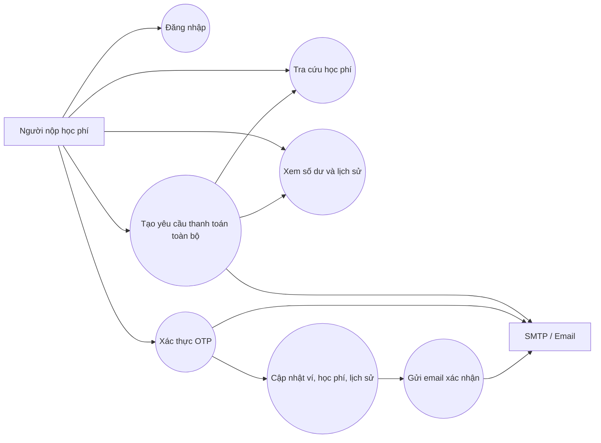
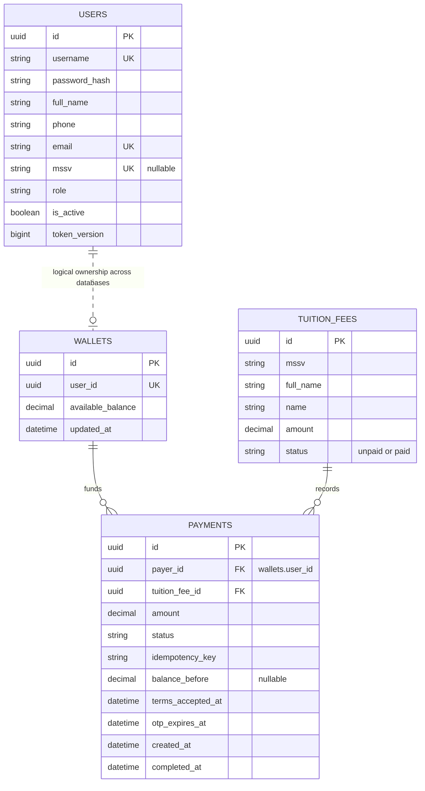
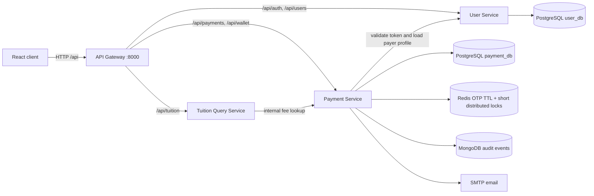

# Thiết kế hệ thống thanh toán học phí

## Use case



## ERD



`USERS` thuộc User Service trong `user_db`. `WALLETS`, `TUITION_FEES` và `PAYMENTS`
thuộc Payment Service trong `payment_db`. Quan hệ users–wallets là quan hệ logic,
không phải foreign key xuyên database. `payments.payer_id` tham chiếu
`wallets.user_id` trong cùng database; request xác thực tài khoản qua User Service.
Một MSSV có thể có nhiều khoản học phí. Unique index có điều kiện giới hạn một
giao dịch đang mở và một giao dịch thành công trên mỗi khoản học phí; idempotency
key là duy nhất theo người nộp. Chi tiết constraint nằm trong
[README services](../services/README.md).

## Microservices architecture



Gateway là cổng API HTTP duy nhất được publish; client được phục vụ riêng qua
Nginx. Tuition Service cung cấp API tra cứu
được bảo vệ đăng nhập; dữ liệu học phí do Payment Service quản lý để thao tác trừ
tiền, đánh dấu đã đóng và ghi giao dịch nằm trong cùng một transaction PostgreSQL.
MongoDB là nhật ký bổ sung, không phải nguồn dữ liệu tài chính.

### Tính nhất quán và đồng thời

- Payment Service mở một PostgreSQL transaction, khóa khoản học phí, ví rồi giao
  dịch theo thứ tự nhất quán bằng
  `SELECT ... FOR UPDATE`, kiểm tra lại số dư/trạng thái rồi trừ tiền, đánh dấu
  học phí và ghi giao dịch trong cùng commit.
- Distributed lock Redis giảm xung đột khi cùng xử lý; khóa hàng
  PostgreSQL, check constraint số dư không âm và unique index thanh toán thành
  công là lớp bảo đảm cuối cùng.
- Redis giữ mã OTP dưới dạng HMAC, TTL không quá 300 giây, dùng `SET NX` để không
  trùng OTP đang hoạt động, khóa claim để ngăn dùng đồng thời và giới hạn 5 lần
  nhập. OTP được xóa sau khi giao dịch kết thúc; trạng thái trong PostgreSQL
  chặn xác thực lại kể cả khi Redis gặp sự cố lúc dọn cache.
- Mongo audit event được ghi trước commit tài chính. Nếu MongoDB không ghi được,
  giao dịch PostgreSQL bị rollback; hệ thống không trả kết quả thành công giả.
- Email OTP phải được gửi thành công trước khi API tạo giao dịch trả thành công;
  lỗi gửi đánh dấu lần thử thất bại và giữ lịch sử. Email xác nhận được gửi sau
  commit; lỗi gửi được log, không biến thanh toán đã thành công thành API thất bại.
- Khi đọc lịch sử, backend cập nhật các giao dịch chờ của chính người nộp đã hết
  hạn trước khi đếm/lấy trang. `completed_at` của giao dịch hết hạn là thời điểm
  `otp_expires_at`, không phải lúc mở lịch sử. Xác nhận và tạo lần thử mới cũng
  kiểm tra hết hạn; không có scheduler hay polling mỗi 5 giây.

## REST API

Tất cả đường dẫn dưới đây đi qua Gateway. Payment endpoints yêu cầu
`Authorization: Bearer <accessToken>`. JSON response dùng camelCase.
Swagger UI được phục vụ tại `/docs/user`, `/docs/tuition` và `/docs/payment`;
schema OpenAPI được gateway chuyển tiếp tới service tương ứng.

| Method | URI | Input | Response | Status |
|---|---|---|---|---|
| POST | `/api/auth/login` | `{ "username": "payer1", "password": "..." }` | access/refresh token, role | 200, 401, 422 |
| GET | `/api/auth/me` | — | `{ "role": "student" }` | 200, 401 |
| POST | `/api/auth/logout` | — | empty | 204, 401 |
| GET | `/api/users/me` | — | id, mssv, fullName, phone, email, role | 200, 401 |
| GET | `/api/wallet` | — | `{ "availableBalance": "1000000.00" }` | 200, 401, 404 |
| GET | `/api/tuition/fees/{studentId}` | — | studentId, studentName, amount, isPaid, tuitionFeeId, name, fees | 200, 401, 404, 502 |
| POST | `/api/payments` | studentId, agreeTerms; tuitionFeeId, idempotencyKey tùy chọn | payment id, amount, status, OTP expiry, idempotencyKey | 201, 400, 401, 404, 409, 422, 502, 503 |
| POST | `/api/payments/{paymentId}/confirm` | `{ "otp": "123456" }` | payment result | 200, 400, 401, 404, 409, 422, 429, 502, 503 |
| GET | `/api/payments` | limit, offset, status, search, dateFrom, dateTo, paymentId | items, total, statusCounts | 200, 401, 422 |

Lỗi nghiệp vụ trả JSON `{ "detail": "..." }`. Số tiền không nhận từ client:
server luôn lấy toàn bộ khoản phải thu từ PostgreSQL, vì vậy không có API thanh
toán một phần. Số tiền trong response được serialize thành chuỗi decimal để
không mất độ chính xác. `POST /api/payments` chỉ tạo yêu cầu OTP, chưa trừ tiền.

Nếu MSSV có nhiều khoản học phí, phải truyền `tuitionFeeId` để chọn rõ khoản cần
thanh toán. Retry cùng ý định dùng lại `idempotencyKey`. Lịch sử luôn giới hạn
theo người nộp; `total` theo bộ lọc, còn `statusCounts` theo toàn bộ lịch sử của
người đó. `dateFrom`/`dateTo` là ngày UTC, bao gồm cả hai đầu; thời gian hiển thị
ở client dùng múi giờ trình duyệt. Tối đa 5 lần gửi xác thực OTP cho mỗi giao dịch;
OTP sai trả số lần còn lại qua header `X-OTP-Attempts-Remaining`.

## Clean initialization

Configure `.env` from `.env.example`, then run `docker compose up -d --build`.
The two databases start empty. Initial migrations create only schema; no accounts,
wallets, tuition fees or payments are preloaded. Provision real data through an
administration process before login or payment.

To reset all project data and stop the stack:

```powershell
docker compose down --volumes --remove-orphans
```

This deletes PostgreSQL databases, Redis OTP state and MongoDB audit data for
this Compose project. See [service setup](../services/README.md) for details.

Chạy test gateway, user, tuition và payment trong tiến trình riêng bằng môi trường
Python đã cài dependencies kiểm thử:

```powershell
python .\scripts\test_backend.py
```

Các test tích hợp trong `test_payment_concurrency.py` chạy trên PostgreSQL riêng,
drop và tạo lại bảng. Trình chạy root chỉ bật nhóm này khi có
`PAYMENT_TEST_DATABASE_URL` và cờ `--with-postgres`. Redis, MongoDB và email được
thay bằng adapter test; PostgreSQL dùng thật để kiểm chứng khóa hàng, constraint
và transaction. Xem [hướng dẫn kiểm thử](testing.md) để chuẩn bị môi trường.
